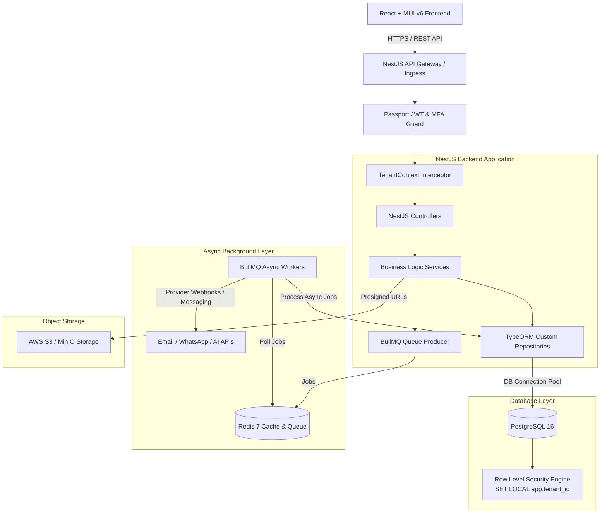
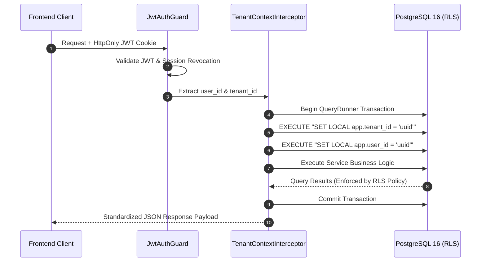

# SYSTEM ARCHITECTURE & COMPONENT BLUEPRINT

# LeadSphere Multi-Tenant Portal

---

## 1. SYSTEM HIGH-LEVEL ARCHITECTURE



---

## 2. NESTJS BACKEND ARCHITECTURE

The backend is structured as a modular NestJS application enforcing strict separation of concerns and Dependency Injection:

```text
apps/backend/src/
├── app.module.ts
├── main.ts
├── common/
│   ├── decorators/         # @RequirePermission(), @Tenant(), @CurrentUser(), @Public()
│   ├── filters/            # GlobalExceptionFilter (Standard Error Payload Envelope)
│   ├── guards/             # JwtAuthGuard, MfaGuard, PermissionGuard, TenantGuard
│   ├── interceptors/       # TenantContextInterceptor (Postgres Transaction & SET LOCAL)
│   ├── middleware/         # RequestLoggerMiddleware (Attaches Request ID)
│   └── pipes/              # CustomValidationPipe (class-validator wrapper)
├── modules/
│   ├── auth/               # Passport local & JWT strategies, TOTP MFA, Sessions
│   ├── tenant/             # Tenant lifecycle, branding, domain settings
│   ├── user/               # Users, invitations, memberships
│   ├── rbac/               # Roles, permissions, group evaluation engine
│   ├── lead/               # Leads CRUD, custom fields, JSONB search, lead scoring
│   ├── pipeline/           # Stages config, Kanban deal management
│   ├── followup/           # Tasks, reminders, user timezone calculations
│   ├── campaign/           # Templates, sequence engine, execution scheduler
│   ├── outreach/           # Email providers, official WhatsApp Cloud API adapters
│   ├── inbox/              # Unified inbox, message threads, WebSocket gateways
│   ├── ai/                 # LLM provider abstraction, prompt sandboxing, usage ledger
│   ├── import-export/      # Streaming CSV/XLSX parser, validation, deduplication
│   ├── document/           # S3 presigned URL generation, document versions
│   ├── analytics/          # Live queries & pre-aggregated rollup engine
│   └── audit/              # Immutable audit logging outbox listener
```

---

## 3. MULTI-TENANT CONTEXT PROPAGATION & RLS

Every HTTP request passing through NestJS executes within an isolated database transaction bound to the caller's `tenant_id`:



---

## 4. FRONTEND ARCHITECTURE (REACT + MUI v6)

The frontend is structured by domain feature modules using Vite and TypeScript:

```text
apps/frontend/src/
├── app/
│   ├── App.tsx             # Root Provider Tree (MUI Theme, QueryClient, Router)
│   ├── router.tsx          # React Router v6 definition with Guarded Routes
│   └── theme/              # MUI createTheme, dynamic Palette overrides
├── components/             # Reusable MUI Component Wrappers
│   ├── data-grid/          # Custom Server-driven DataGrid with virtualized scrolling
│   ├── feedback/           # Toast Snackbar, ConfirmDialog, LoadingSkeletons
│   └── navigation/         # Workspace Sidebar, Header Bar, Command Palette
├── features/               # Self-contained feature modules
│   ├── leads/              # LeadList, LeadDetail, LeadForm, LeadImportWizard
│   ├── pipeline/           # KanbanBoard, StageColumn, DragDropCard
│   ├── campaigns/          # CampaignBuilder, SequenceEditor, AudienceSnapshot
│   ├── inbox/              # ConversationThread, MessageComposer, ChannelFilter
│   └── followups/          # CalendarView, TaskList, SnoozeDialog
└── services/               # Axios OpenAPI Client with Request ID & Refresher
```

---

## 5. BACKGROUND QUEUE ARCHITECTURE (BULLMQ)

Async background tasks are segregated into dedicated Redis queues to avoid worker starvation:

| Queue Name | Priority | Workers | Purpose |
|---|---|---|---|
| `critical` | High | 10 | Real-time email/WhatsApp message delivery, 24-hr window checks |
| `default` | Normal | 5 | Follow-up reminders, lead score recalculation, webhook processing |
| `bulk` | Low | 2 | Large CSV/XLSX imports (chunks of 1,000), bulk exports |
| `ai` | Capped | 3 | Async LLM text generation, reply classification, prompt summaries |

---

## 6. OBJECT STORAGE ARCHITECTURE

All files uploaded to S3 / MinIO strictly adhere to tenant-isolated storage key formats:
* **Documents:** `tenants/{tenant_id}/documents/{document_id}/v{version_number}/{filename}`
* **Imports:** `tenants/{tenant_id}/imports/{import_id}/original.{csv|xlsx}`
* **Exports:** `tenants/{tenant_id}/exports/{export_id}.csv`

Direct uploads and downloads utilize **short-lived S3 Presigned URLs** (15-minute TTL) generated only after database authorization verification.
